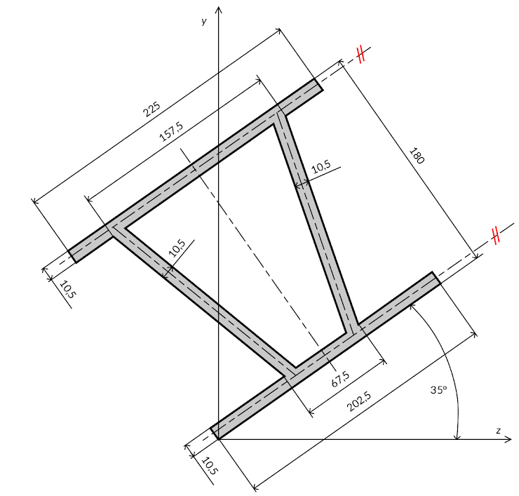

# Problem 1058

For the gray cross-section and its coordinate system given in the figure below, it is necessary to calculate:
- Center of gravity in mm (zT, yT)
- Moment of inertia Iz in millions of mm4
- Moment of inertia Iy in millions of mm4
- Moment of inertia Izy in millions of mm4
- Radius of Gyration rz in mm
- Radius of Gyration ry in mm

Notes: Round the centers of gravity in mm to two decimal places. Round the moments of inertia in millions of mm4 to three decimal places. Round the radii of Gyration in mm to two decimal places. Write with commas instead of dots, without the units of measurement.

Answer: zT, yT, Iz, Iy, Izy, rz, ry

