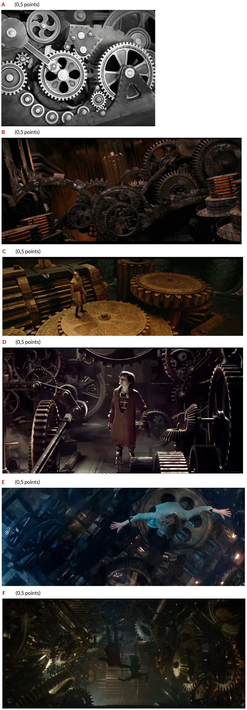

# Problem 1059

Gears seem to be very popular in the film industry, either as a detail or as an important part of the content. Based on the figures shown below, name the film that the clip is associated with.

Answer: a, b, c, d, e, f

