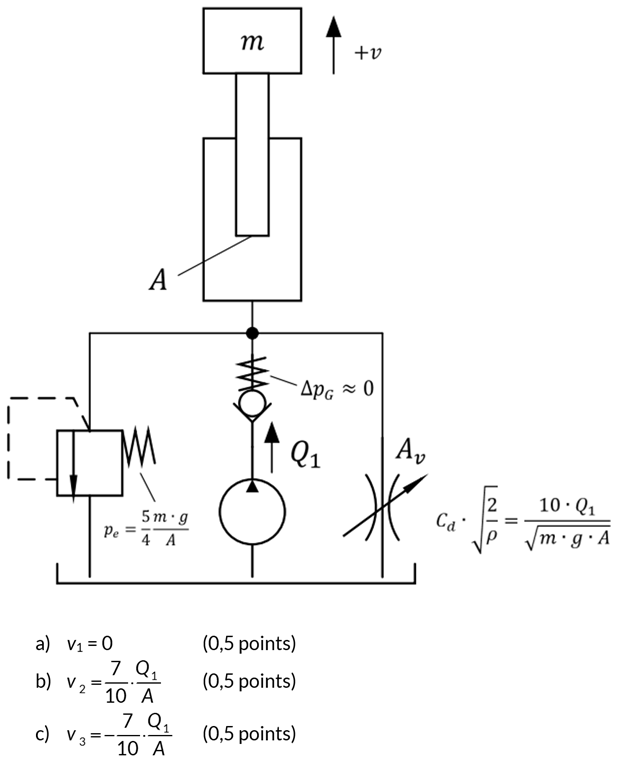

# Problem 1060

The figure below shows a simplified hydraulic system consisting of a pump, a pressure relief valve, a check valve, an adjustable flow control valve and a plunger cylinder.
Working principle: The pump delivers oil to the cylinder. A check valve ensures that the oil flows only toward the actuator. An adjustable flow control valve regulates the speed of the piston movement. If the system pressure exceeds the permissible limit, the pressure relief valve opens and diverts the excess oil back to the tank, protecting the components. The cylinder then carries out the desired work task. Losses are not considered!

Note: Write all the answers as the following combination: [number] x [parameter]. The number should be written with two decimal places.

Given parameters: m, a, Q1.

Calculate the flow area Av of the adjustable flow control valve as a function of the given parameters, so that the following is obtained:
Answer: a, b, c

