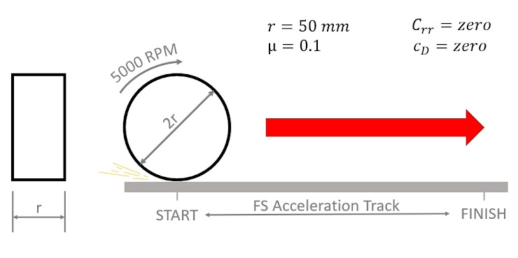

# Problem 1064

A cylinder (mass of the cylinder is unknown, 100 mm diameter) is spun to 5000 RPM and put on a surface. The friction coefficient between the disk and the surface is 0,1. When the disk is released, it starts accelerating forward. In what time will the disk travel 75 meters?

Note: Write the number in seconds and round the answer to two decimal places.

