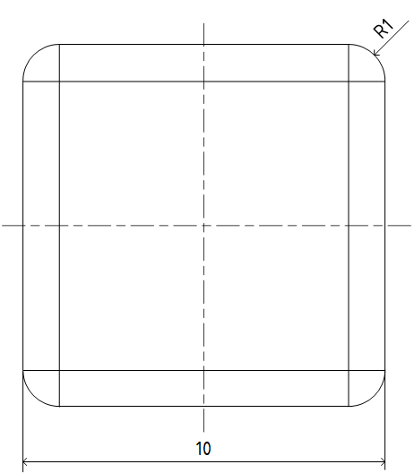

# Problem 1066

You are presented with a small, rounded cube on this https://fs-quiz.eu/doc/quiz/fsaa26/cube.STEP. Your objective is to determine the following:

a) Moment of inertia for all three axes (x, y, z) in grams * square millimeters rounded to two decimal places. The coordinate system is in the center of the cube.

b) Maximum von Mises stress in MPa rounded to two decimal places.

You are also given these inputs:
· The material of the cube is Titanium Ti-5Al-2.5Sn with these properties:
o Elastic modulus: 110300 N/mm2
o Poisson’s Ratio: 0.31
o Shear Modulus: 48000 N/mm2
o Mass Density: 4480 kg/m3
o Tensile Strength: 861 N/mm2
o Compressive Strength: 830 N/mm2
o Yield Strength: 827 N/mm2
· To determine the Maximum von Mises stress, use these input data:

Material model
· Linear elastic, homogeneous, isotropic
· Elastic modulus: 110300 N/mm²· Poisson’s ratio: 0.31

Analysis type
· Static structural analysis
· Small-strain formulation
· Geometric nonlinearity disabled

Boundary conditions
· One flat face of the cube (excluding fillet surfaces) fully fixed in all translational and rotational degrees of freedom

Load
· Uniform compressive surface traction applied to the opposite flat face (excluding fillets) from the one defined with boundary conditions
· Total resultant force: 100 N, acting normal to the surface

Meshing
· 3D quadratic tetrahedral solid elements (10-node or equivalent: for Abaqus C3D10, for Ansys: SOLID187, etc.)
· Average element edge length: 2,5 mm ± 10%
· Total element count: approximately 600–750 elements

Note: If you are having trouble with the cube on the link, here is a technical drawing so you can design it yourself:

Answer: a, b

