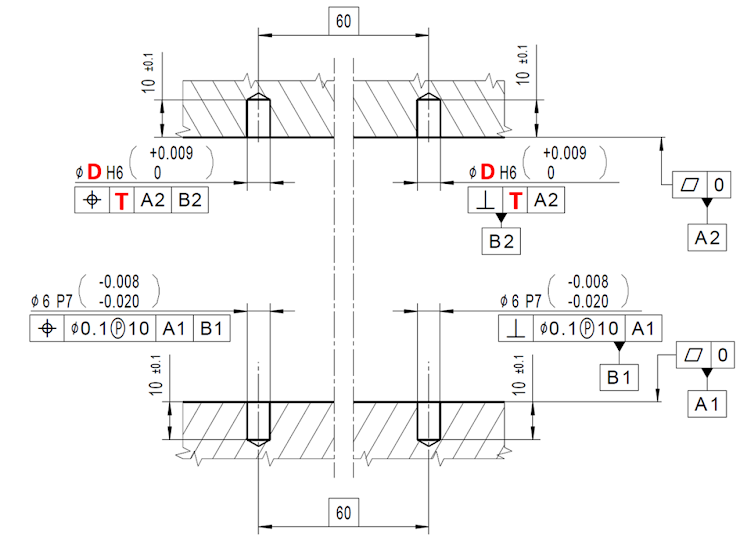

# Problem 1067

For which can assembly of the two parts shown (using dowel pins) be guaranteed if produced according to specifications:Notes:- Dowel pins used for assembly are DIN 7979 shape- 2x ⌀6h6x20- General product Specifications: ISO 8015- Linear size ISO 14405 Ⓔ- General tolerances: ISO 22081- Edge finish: ISO 13715- Surface Texture: ISO 21920-1- (Dots in the figure should be replaced with commas)

Options:
- A) D = 6; T = ⌀0Ⓜ
- B) D = 6,1; T= ⌀0,1Ⓜ
- C) D = 6,1; T = ⌀0Ⓜ
- D) D = 6; T = ⌀0,1
