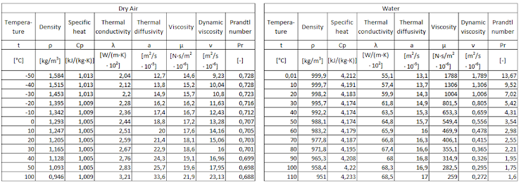

# Problem 1069

Your team has 3D printed a 15 % scale model of your FS vehicle. It seems that you’re in luck – the university offers you to perform a test in a water tunnel instead of a wind tunnel. Your objective is to calculate (with a precision of 0.01 m/s) the speed at which water must flow through the tunnel to accurately represent the airflow around a full-scale vehicle, driven at 20 m/s. Consider that the desired dry air temperature is 30 °C, and the supplied water will be at 20 °C.

Determine if the pump supplied by the university can experiment with that calculated speed, knowing that:
- The water pump has a capacity of 95000 l/min,
- Tunnel cross-section is 0,2 m2,
- Tunnel length is 3,1 m,
- Vehicle model occupies 10% of the tunnel cross-section area and 0,5 % of the tunnel volume,
- Disregard any possible effect from moving the ground.

Note: Write your answer in the following format (without the parentheses) with two decimal numbers: [x,xx] x [Yes/No].

Additional information on figure below:

