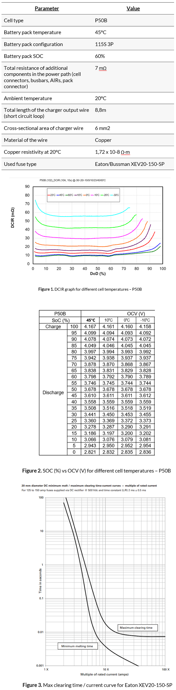

# Problem 1070

Your team embarks on the important mission of figuring out whether the TS accumulator main fuse is correctly sized and not just pretending to be. Along the way, you discover that various industry standards all have their own opinions on what a proper short-circuit test for a tractive battery pack should look like. To keep things practical (and slightly dramatic), you decide to evaluate the fuse under the most likely real-life scenario you can imagine. This involves a short circuit at the charger output connector, occurring while the battery is partially discharged and has been thoroughly warmed up by high ambient temperatures.

Using the parameters and assumptions attached, please calculate the maximum time it takes to open the circuit when short circuit condition is triggered (fuse maximum clearing time).  Round the answer to the closest integer in ms.

Notes/assumptions:
- Temperature of the cells stays constant for the whole duration of the short circuit condition
- Temperature of the conductive elements in the high current path stays constant for the whole duration of the short circuit condition
- Assume that battery pack was not charged or discharged

Sources:
- Eaton XEV20-150-SP datasheet - https://www.eaton.com/content/dam/eaton/products/emobility/fuses-electric-vehicle/bus-ele-ds-10863-ev-pre-production-sample-power-fuses.pdf
- Molicel P50B technical information

