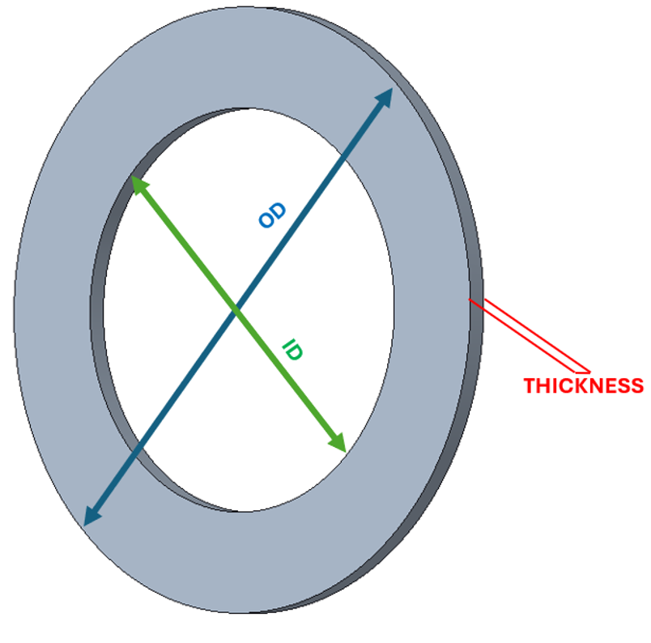

# Problem 1071

A race car is going on the long straight at 180 km/h. Unfortunately, the rear brakes don’t work, so it can use only the front brakes to slow down. It is approaching a slow right corner, for which the entering speed must be no more than 90 km/h. While braking, the weight distribution is 60% front and 40% rear. Assume:
- No heat transfer from the brake discs to the wheel hub
- Braking force is constant
- Brake discs are “floating” type, solid (non-ventilated)
- Assume no aerodynamic forces are acting on the car (no “aero” braking)
Car info:
- Mass = 1200 kg
- Effective diameter of the front brake discs = 350 mm
- Average friction coefficient for the front brake pads/discs μ = 0,38
- Average braking force (per 1 calliper) = 55 kN

Your job is to calculate:

A) Total energy to be dissipated to slow down the car to 90 km/h, give the result in J, rounded to the closest integer.

B) Braking torque per 1 disc, give the result in Nm, round the results to 1 decimal place.

C) Temperature increase of 1 brake disc if the weight of a brake disc is 7,2 kg, specific heat c = 460 J/(kg*K), and 70% of energy is transferred to the brake disc. Give the result in °C, round to the nearest integer.

Answer: a, b, c

