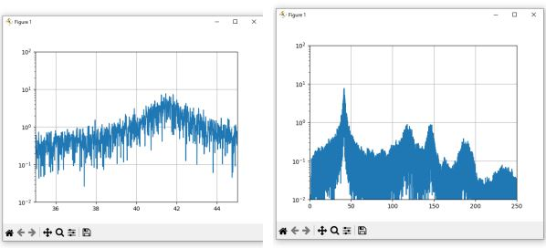

<!-- Imported from FS Quiz. Delete this line to keep your edits when the import runs again. -->
# Solution 622

Step 1: Translate data (notepad++), Change blank space to TAB, Change ',' to '.'\n Step 2: Example: Python, Use fft analysis script (Numpy), Sample rate: 2kHz = 2000Hz

