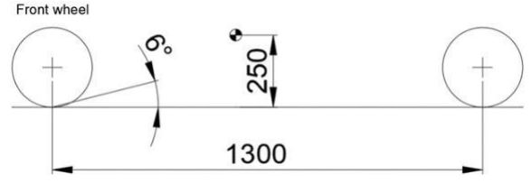

# Problem 627

The following side sketch represents the side of a car equipped with outboard brakes that provides 65 % of braking on front brakes. In the side view, the swing arm is inclined for 6°.\n Calculate the anti-dive percentage (round up to the first decimal place).

