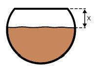

# Problem 853

You and your team just passed scrutineering and now you are cooking stew (corba) for you and 170 of your friends in Formula Student Alpe Adria 2024. Each person gets a portion measuring exactly 300 ml. You cook in a spherical pot with an inner diameter D = 0,5 m. The pot has one circular opening at the top measuring A = 30 cm in diameter. How much do you have to fill up the pot to have the exact amount of stew for everyone? You can only measure the height between the top of the opening and the liquid surface. Round the answer (x) to the nearest centimetre.

