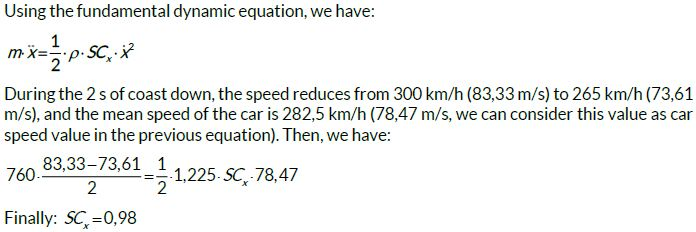

<!-- Imported from FS Quiz. Delete this line to keep your edits when the import runs again. -->
# Solution 856

Part 2: The medium speed of the car during the coast down is 282,5 km/h (78,47 m/s). So, during the 2s of coast down, the car travels a distance of 78,47*2=156,9m.

