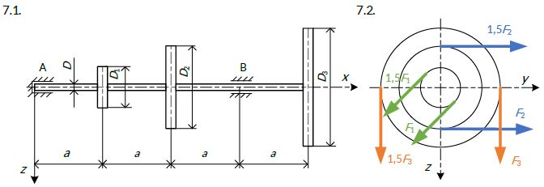

# Problem 859

Figure 7.1. shows the shaft from a Formula Student car from the year 2530 on which there are three pulleys. The shaft is supported on a radial-axial bearing at point A and a radial bearing at point B. The pulley forces are shown in the side view in figure 7.2 It is necessary to determine the shaft diameter d (round to a whole number) according to the theory of maximum shear stress.\nParameters:\nF1 = 500N, F3 = 500N, a = 0,25m, D1 = 240mm, D2 = 320mm, D3 = 400mm, O(allow) = 120 MPa.\n\nNote: F1 forces are parallel and at an angle of 45° to the y axis. F2 forces are horizontal andparallel, F3 forces are vertical and parallel.

