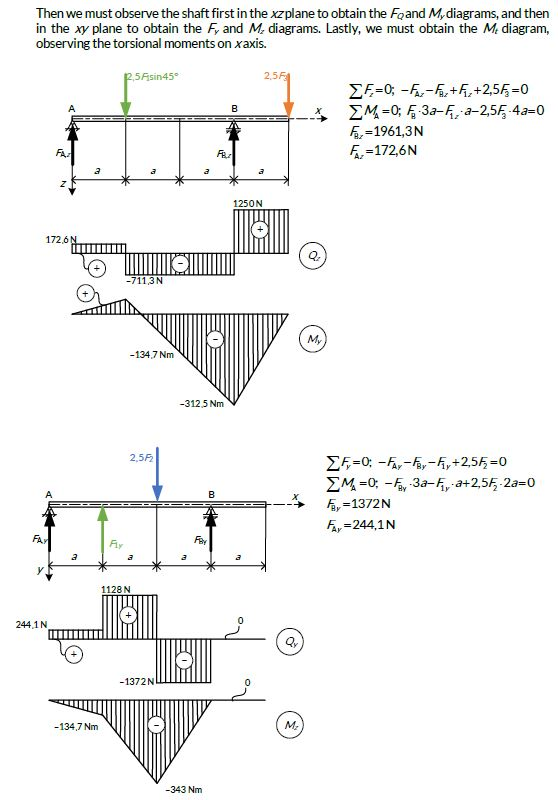
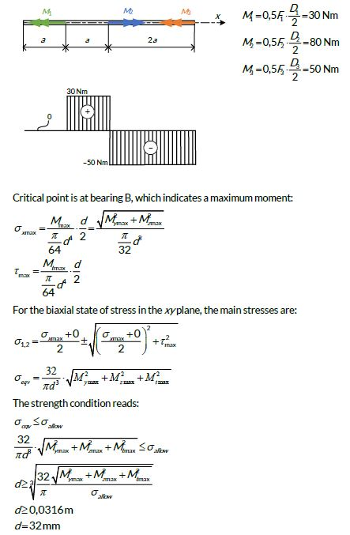

<!-- Imported from FS Quiz. Delete this line to keep your edits when the import runs again. -->
# Solution 859

The force F2 will be obtained from the balance equation of the shaft for the x axis:

