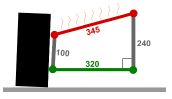

# Problem 862

While testing your CV car, the driver notices the rear of the car behaves differently in left and right corners when he starts driving. After a couple of laps, the problem almost disappears. You suspect the reason of this behaviour might be the exhaust, which heats up the aluminium upper rear right A-arm and cools down while driving.\nIt turns out, the exhaust can increase the temperature of the upper A-arm by 200 °C! Calculate by how much would the raised temperature change the camber on the rear right wheel. Dimensions of components at the nominal temperature are presented on the figure below. Bottom A-arm is perpendicular to the vertical chassis member. Write the answer in degrees rounded to the nearest one decimal place number.\nNote: Linear expansion coefficient for aluminium is 0,000023 m/m °C.

