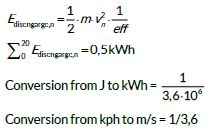
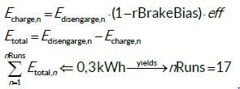

<!-- Imported from FS Quiz. Delete this line to keep your edits when the import runs again. -->
# Solution 863

Part 1:

Part 2:

Part 3: This is a slightly tricky one, because you take the sum of 19 runs and add only discharge of run #20, otherwise you would end up going negative in the final run (or stopping on track).
