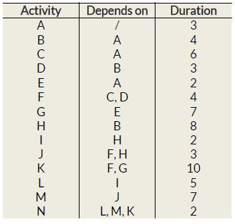

# Problem 865

The table below defines activities of a certain process, their dependence and duration.\nThis task requires you to:\n\nPart 1: Draw a precedence diagram of the whole process, method is finish to start, final version of the diagram should not contain fictional nodes if they were used during creation, use of Fulkerson’s rule is advised.\n\nPart 2: Define which is the critical path. Write the answer in this format: X-X-X… alphabetically.\n\nPart 3: Draw a linear time plan of the process:\n- Spare/idle/reserve times should be marked with one type of line.\n- Activity times should be marked with another type of line.\n- Critical path should be marked with another type of line.\n\nPart 1 & 3 are not available because an upload is not supported

