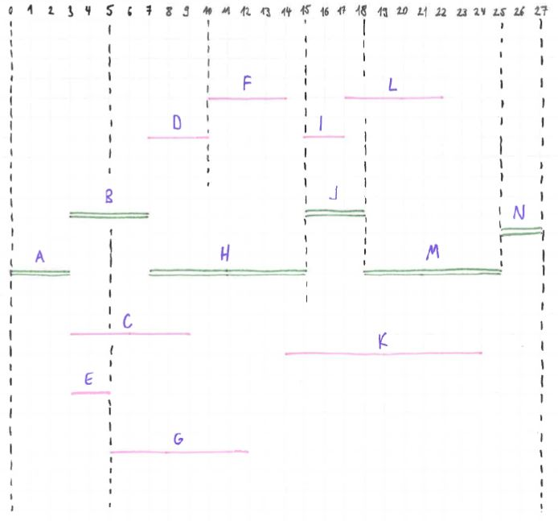

<!-- Imported from FS Quiz. Delete this line to keep your edits when the import runs again. -->
# Solution 865

Part 1: Anything that depicts the same data/numbers/content as shown below, students are free to draw by hand or use computer tools and a lot of freedom is allowed.

Part 3:

