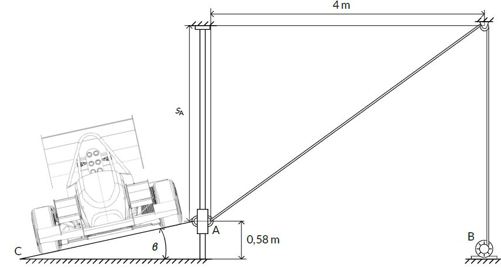

# Problem 867

Have you ever paid attention during the tilt test? You will now!\nIn the figure below, a tilt test by a random Formula Student competition is being presented. The motion of the collar at A is controlled by a motor at B such that when the collar is at = A 3 m, s it is moving upwards at 2 m/s.\n\nPart 1: Determine the velocity of a point on the cable as it is drawn into the motor B at this instant.\n\nPart 2: What is the angle β at the same moment if the horizontal component of the distance between points A and C is by 8000% larger than the minimum allowed ground clearance for a Formula Student car? \n\n Note: Round the answers to 1 decimal number.\nAnswer format: {Part 1}; {Part 2}

