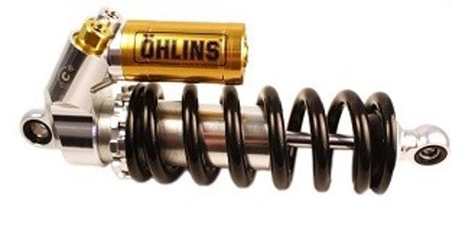

# Problem 101

Your car weighed:
FL: 59kg, FR: 60kg, RL: 72kg,RR: 68kg
Using equal amounts on all four corners, how many rotations do you have to adjust the spring seat nuts on the coilovers?
motion ratio (swheel/sdamper) = 2
spring stiffness = 33N/mm (all around)
coilover thread pitch = 1.5mm
independent suspension, no ARB preload

Options:
- A) ± 1/4 turn
- B) ± 2 turns
- C) ± 1 turn
- D) ± 1/2 turn
