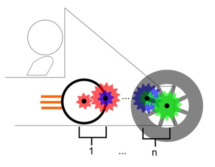

# Problem 102

You decide to use a geartrain to connect your motor to your rear axle.Using the constraints below, calculate the minimum number of gear stages (n) needed to accomplish this. Top speed should be reached in final gear at max. RPM.
imax (per stage) = 6
vmax = 160 kph
nmax = 20000 rpm
wheel diameter = 15 inch

Options:
- A) n=4
- B) n=3
- C) n=2
- D) n=1
