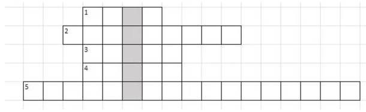

# Problem 1075

Complete the crossword puzzle. The word in the gray boxes is the solution.
Convert all letters from the solution word into numbers (a=1, b=2, c=3, etc.).
Sum all number converted letters to one single number.

1: Slightly wet, not dry
2: Dynamic Discipline, approximately 22 km
3: Mass * Acceleration
4: System to slow a vehicle down
5: p   0.5 * rho * v^2   rho * g * h = const.

