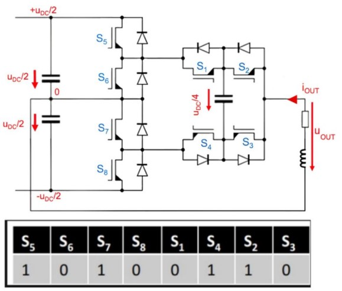

# Problem 1082

One of your team members has fulfilled his long-standing dream of designing a new inverter for the team.
Unfortunately, during the design process he became a little too enthusiastic and decided to implement one of the most complex topologies imaginable, as shown in the schematics.
When you confront him about this, he insists that the circuit is “not that complicated at all”.
Your task is to determine the output voltages U_out for the given switch configuration.
A switch position of 1 indicates ON, and 0 indicates OFF.

Options:
- A) 0
- B) UDC
- C) UDC/2
- D) -UDC/2
- E) UDC/4
- F) -UDC/4
