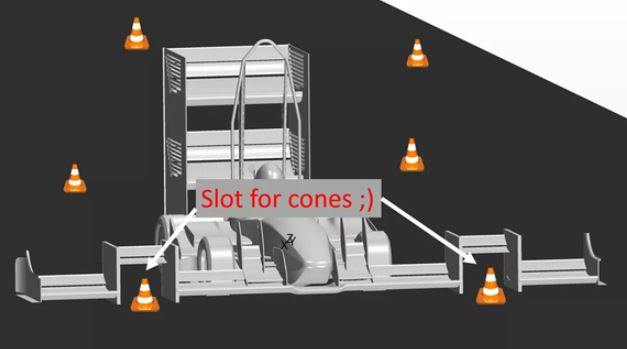

# Problem 111

Which of the following statements about the legality of the car below is true?
+ track width = 2500mm
+ car track = 1700mm
+ cone height = 280mm
+ rear wing height = 2100mm
+ roll hoop height = 2200mm
Image © TU Munich

Options:
- A) rear wing is too wide
- B) cone slots would have to be movable (illegal movable aero devices)
- C) endplate gurneys are generally not allowed
- D) front wing overall width is too wide
- E) the structure around the cone slots is too high
