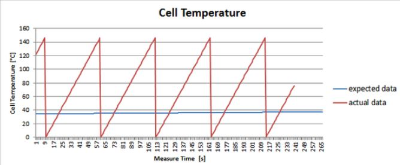

# Problem 112

During charging you monitor the cell temperatures by tapping the BMS CAN Bus. The Temperature is transmitted as 16-bit unsigned integer (0.00229 °C/bit).
Looking at the data the temperatures look somewhat implausible (see picture below) - what went wrong most likely?

Options:
- A) The signed-ness is wrong
- B) The endianess is wrong
- C) The can bus is overloaded
- D) The conversion factor is wrong
- E) This is actually the cell voltage
