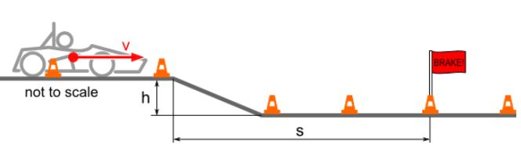

# Problem 115

Imagine you’re running AutoX in FSA 2016. You need to limit your speed because of the following corner. What is the fastest can go at the crest/edge and still land before the beginning of the braking zone?
+ h = 0.25m
+ s = 5m
+ g = 9.81m/s²
+ Consider the car a point mass, Ignore aerodynamic effects.

Options:
- A) 22.5 m/s
- B) 70.0 km/h
- C) 25.2 m/s
- D) 81.3 km/h
- E) 79.7 km/h
