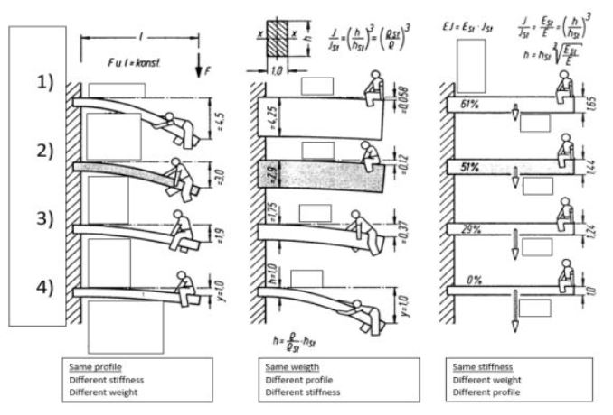

# Problem 136

Beams - Which is which?

Options:
- A) 1) aluminium, 2) magnesium, 3) titanium, 4) steel
- B) 1) aluminium, 2) magnesium, 3) steel, 4) titanium
- C) 1) aluminium, 2) steel, 3) titanium, 4) magnesium
- D) 1) magnesium, 2) aluminium, 3) titanium, 4) steel
