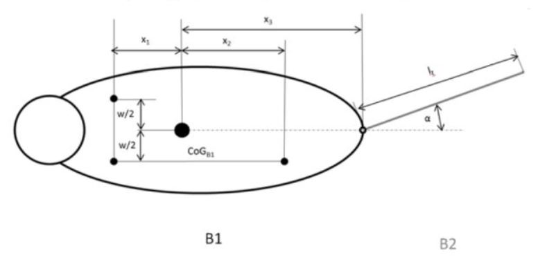

# Problem 143

The car of an FSA technical inspector stays away from balconies but has lost a leg in a terrible racing accident. The simplified mechanical model of the cat consists of a solid body (B_1) that represents the head, torso and legs. The body B_1 has the mass m and the dimensions that can be taken from the sketch (top view of the cat). The 3 legs are assumed to be vertical bars. The cat's tail is modeled as a beam B_2 with the line load q. This is connected at the height of the center of gravity with B_1 and can be privoted in the horizontal plane.
x_1 in mm: 100
x_2 in mm: 250
x_3 in mm: 275
w in mm: 125
I_t in mm: 400
m in kg: 2
q in kg/m: 0.5
alpha in deg: 30
The cat moves its tail by the angle alpha to the right. Which of the following statements is true?

Options:
- A) The cat is in an unstable equilibrium.
- B) The cat loses stability and falls over to the left.
- C) The cat loses stability and falls over to the right.
- D) The cat is in a syable equilibrium.
