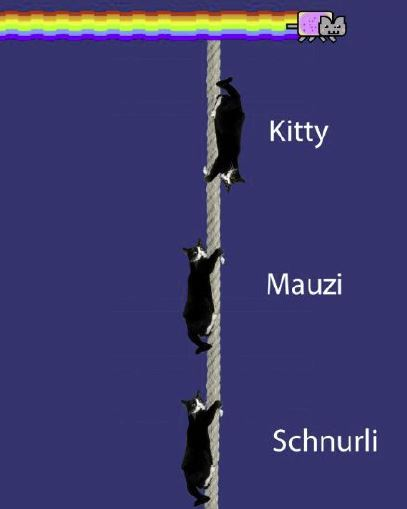

# Problem 146

At FSA 2020, three cats, Kitty (5kg), Mauzi (3kg) and Schnurli (4kg), are climbing up and down along a rope. At a certain moment Kitty descends with an acceleration of 1.6m/s², Schnurli pulls herself up with an accerleration of 90 Gal, while Mauzi climbs up with the constant speed of 1.968 feet/s.
What is the load on the rope hanger at this moment? (mass of rope neglected, consider gravity g=9.80665m/s²)
Round to first decimal.

Options:
- A) 115.8N
- B) 122.8N
- C) 113.3N
- D) 130.0N
