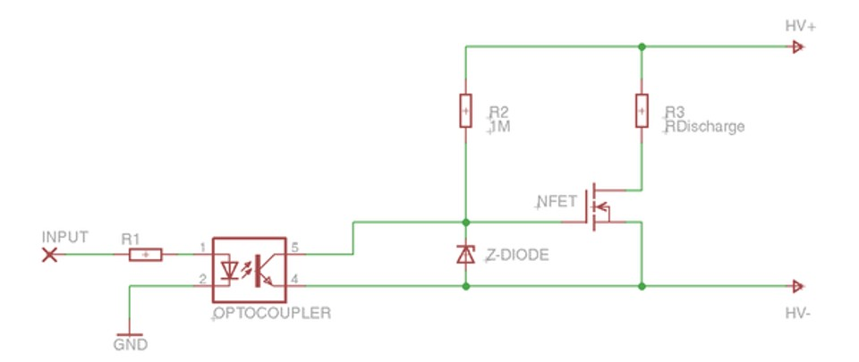

# Problem 149

Consider this discharge Circuit. What does the input do?

Options:
- A) Input HIGH enables the discharge
- B) Input LOW enables the discharge
- C) Input HIGH shorts the HV
- D) The input does nothing
