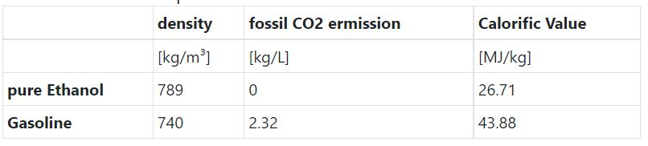

# Problem 151

Your current race car burns 4 liters of RON100 gasoline in your IC engine during an endurance race. By what amount [kg] you may lower your fossil carbon dioxide emissions by using a E85 mixture (per volume) as biofuel?
Assume complete combustion and the same amount of chemical energy needed to run your engine on E85 fuel during an endurance. Consider the properties below.
round to 2 decimal places and number format be like "3.14".
Please use the following format: 12.34

