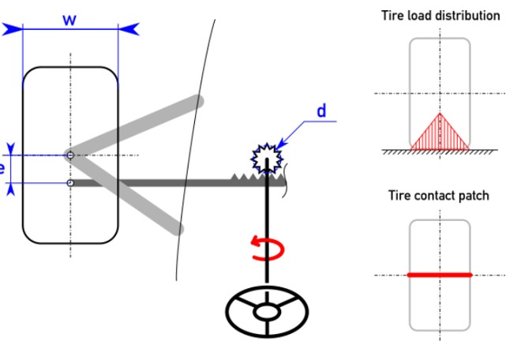

# Problem 29

Your car has a suspension geometry with zero caster, camber and toe. The tire contact path is assumed to be linear, the contact force distribution is assumed to be triangular (see image). How much steering torque applied on the steering wheel is required to move the steering from the center postion during standstill?
Tire width w: 7 inch
Control rod arm e: 95mm
Pinion meshing diameter d: 34mm
Weight of car /w driver 272kg
Weight distrubution /w driver: 48% Rear
Static tire µ: 1.5 (CoF)
g= 9.81 m/s²
Answer in [Nm] rounded to .1

