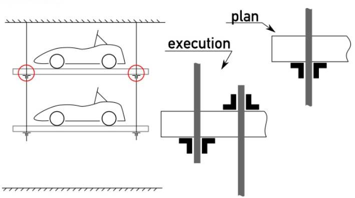

# Problem 31

You plan a nice display for your race cars in your shop consisting of platforms suspended on steel tie rods. All parts are delivered as designed, but you notice that the assembly was done differently. Is this a problem?

Options:
- A) Yes, because the nuts might be overloaded
- B) No, all parts are still bearing their design loads
- C) Yes, because the ceiling mounts might be overloaded
- D) Yes, because the tie rods might be overloaded
- E) Yes, because some of the nuts are loaded in the wrong direction
