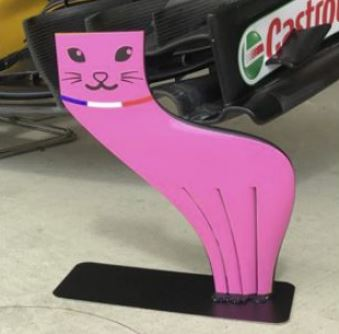

# Problem 365

Your car is equipped with a front and rear wing. The aerodynamic balance is given as 46:54 (front: rear), the weight distribution is 50:50 (front: rear). During the testing phase of your team, you have encountered a magical animal that can produce aerodynamic downforce without raising the car's drag. On which position of the car would you place the aerocat, in order to increase the maximum corner potential of the car in a left turn?

Options:
- A) Front wing right side
- B) Front wing left side
- C) Front wing middle side
