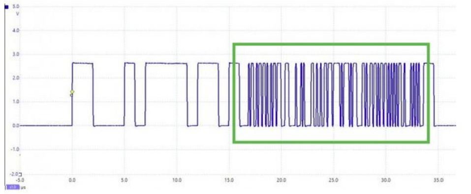

# Problem 369

You capture this CAN FRAME with your scope. What happend in the market section?

Options:
- A) It's a CAN FD Transmission
- B) During transmission, a collision with another transmitting node occurred
- C) There is EMI/Noise coupled outo your CAN bus lines
- D) Nothing special, this is a standard CAN 2.0 frame with a bit rate of 1 Mbit/s
- E) Probably a broken Transceiver on the sending node
