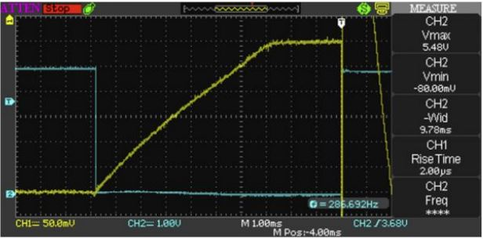

# Problem 371

The LV system of your car consists of following electrical consumers:
ECU: 2Amps
Water pump: 6 Amps
Fan: 10 Amps
other devices: 4 Amps
All devices draw constant current, but the fan is only active 75% of the time. Endurance is expected to last exactly 25 minutes.
What is the absolute minimum battery capacity (in Ah) required in order to finish the endurance on battery charge alone? Round to 3 decimals
Please use the following format: 12.34

