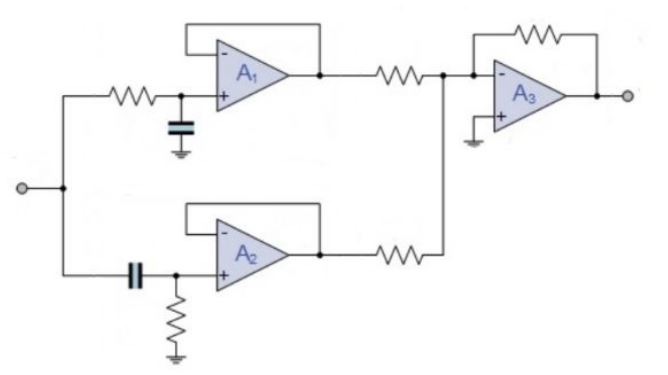

# Problem 375

You have an electric car and always when your car visits the workshop she runs away when you turn on the car. You think she is afraid of the inverter switching frequency, which is 18kHz. You want to design noise-canceling headphones for your cat where you want to integrate a band stop filter.
You wnat to reject fraquencies from 17 to 19kHz (-3db Points) with your circuit. Consider all resistors with a nominal value of 10kOhm.
What capacitor do you need? (round to integer)

Options:
- A) Clp=936pF, Chp=838pf
- B) Clp=5263pF, Chp=5882pf
- C) Clp=838pF, Chp=939pf
- D) Clp=5882pF, Chp=5263pf
