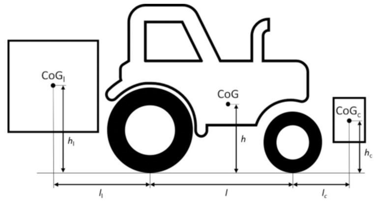
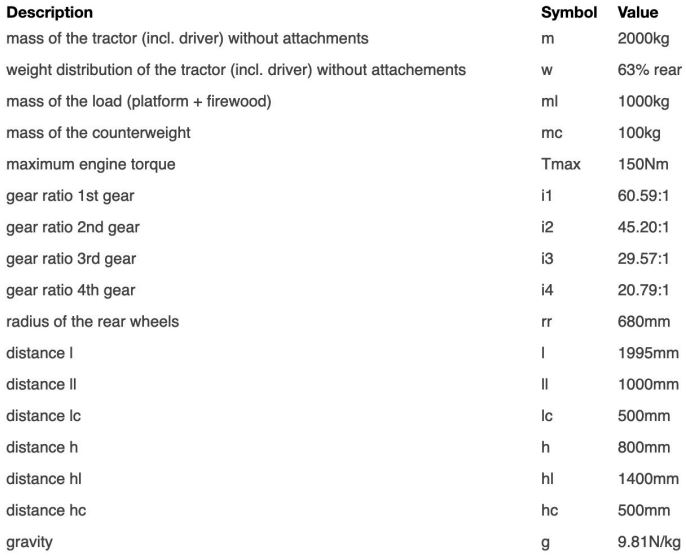

# Problem 459

The campground operator has developed a new business model and offers firewood for sale to the teams. Some teams accept the offer and have firewood delivered for their pools and sauna. To deliver the firewood, he has mounted a platform on the rear of his tractor and a counter weight on the front (see sketch).\n While the campsite operator is delivering the firewood with his rear wheel driven tractor, he is challenged by some team members to do a wheelie.\n What is the highest gear in which a wheelie is still possible?\n Neglect rolling and air resistance as well as roational inertia for your calculations.

Options:
- A) 1st gear
- B) 2nd gear
- C) 3rd gear
- D) 4th gear
- E) it is not possible to do a wheelie in this configuration
