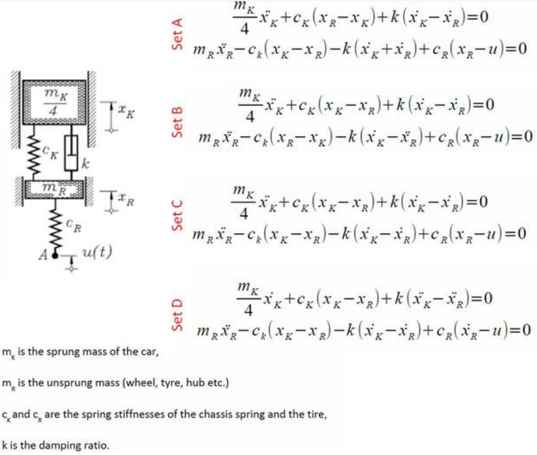

# Problem 467

One corner of your car's suspension can be simplified as a two-mass system with two springs, a damper and an excitation function u(t).\n Which set of differential equations represents the system shown below?

Options:
- A) Set A
- B) Set B
- C) Set C
- D) Set D
