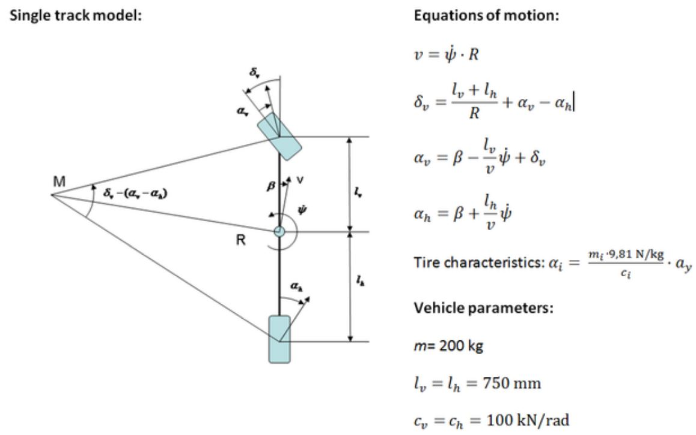

# Problem 470

Use the given linear single track model and parameters of a formula student vehicle to calculate the side slip angle ẞ during skid pad (quasi static cornering).\n Assume the vehicle is driving on the centreline and the run time is 5.5 sec (no penalties). Calculation hints: use full precision for intermediate results and pi.\n ay is the lateral acceleration\n Answer: in degrees, round to 0.01

