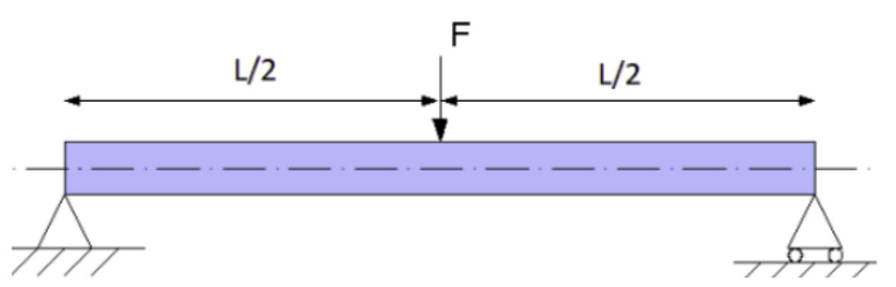

# Problem 473

Calculate the force at the yield strangth for a single tube in the given 3-point bending test setup\n Tube: square steel tube 25x25x2.2 (no rounded edges)\n Use the approximation of 1D-beam elements and the yield strangth from the rules.\n L=400\n Use full precision for intermediate calculation and PI\n Answer in kilonewtons rounded to 0.01

