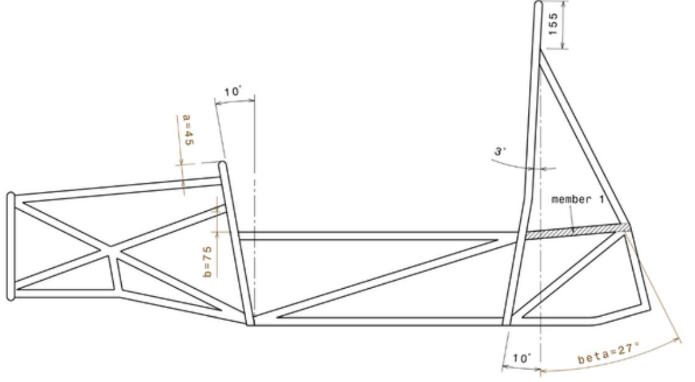

# Problem 474

Given below is a side view of a tubular steel frame. Which of the following statements is true under all circumstances? (dotted line = vertical, distances in mm)

Options:
- A) The attachment of the main hoop bracing at the main hoop is too low
- B) Angle "beta" is too small
- C) Additional structural members are mandatory below member "1" in the rear end
- D) Additonal members above member "1" in the rear end are mandatory
