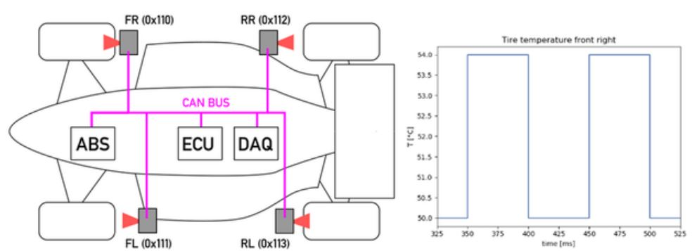

# Problem 479

Your car is equipped with one tire temperature sensor node per wheel. They are connected to the DAQ system via common CAN bus.\n Sensor Accuracy is 0.5 degC\n data format is 10-bit unsigned integer; quatisation 0.25 degC/bit, offset 0 degC\n Message Interval is 100ms\n When reviewing the data, you notice the following pattern on one of the logged temperature channels

Options:
- A) Your infrared thermometer is configured for a wrong radiation emission coefficient
- B) Two sensor nodes are configured to the same CAN ID
- C) The can bus is overloaded
- D) This is an expected result with the given accuracy of the sensors
- E) The endianness is wrong in the DAQ config
