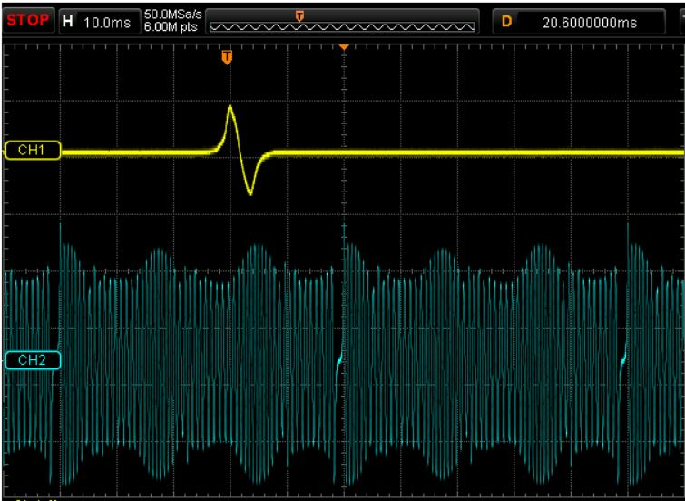

# Problem 485

This is a trace of the cam and crank sensor signal of a-stroke engine.\n The crank has a 60-2 trigger pattern, how many cylinders does it likely have?

Options:
- A) 2
- B) 3
- C) 4
- D) 6
- E) 8
