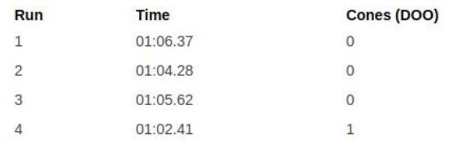

# Problem 647

Autocross Scorring: Competing in the FSA 2023 autocross event, your team achieves the following run times: The fastest time in your class is 00:58.49. What is your final autocross score? Round your result to the nearest integer.

Options:
- A) 72 points
- B) 57 points
- C) 83 points
- D) 56 points
