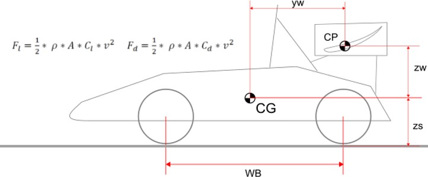

# Problem 65

How much does the vertical load on each rear tire increase at 72kph when the wing shown in the sketch is used vs. running without wing?
density = 1.2 kg/m^3
Wheelbase = 1.6m
Wing: cl*A = 0.6 m²
cd*A = 0.3m²
yW = 0.8m
zW = 0.4m
zs = 0.3m
Static weight distribution = 51% rear
ignore wing weight
car is completely stiff

Options:
- A) 7.0 kg
- B) 8.0 kg
- C) 10.0 kg
- D) 9.0 kg
