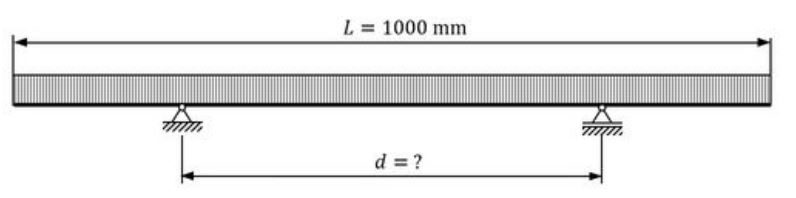

# Problem 657

Bending Beam: For the beam in the sketch below, find the optimum distance d in millimeters between the two supports so that the maximum of the bending stress anywhere in the beam is minimal. The beam is loaded by a constant line load acting in a downwards direction. Consider that the system is symmetric and that the beam has a constant cross-section and is made from homogenous linear-elastic material.Round your result to one decimal place. (Hint: consider only the points in each section where you expect the highest bending stress)

Options:
- A) 616.1mm
- B) 585.8mm
- C) 535.3mm
- D) 858.5mm
