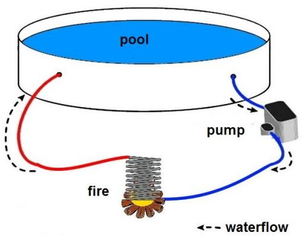

# Problem 830

You want to heat up your pool at the FSA campsite by burning wood. You brought a heat exchanger like shown in the sketch.\nUnfortunately, you didn't bring any wood, and now you have to buy it from the campground owner.\nHow much wood do you need to buy to raise the temperature in your 4 m diameter pool with a 0.95 m water height from 12 °C to 20 °C, given the following values?\nOverall efficiency of the water heating system: 35%\nEnergy content of the firewood: 4 kWh/kg\nSpecific heat capacity of water: 4184 J/kgK\nWater capacity of the heating system outside the pool: 15 l\nDensity of water 1000 kg/m^3\nOther influences on the temperature other than the heating system itself are not taken into account\n(e.g. ambient temperature, heat capacity of the pool itself)\n(Give your answer in kg, round to two digit after the decimal points)\nPlease use the following format: 12.34

