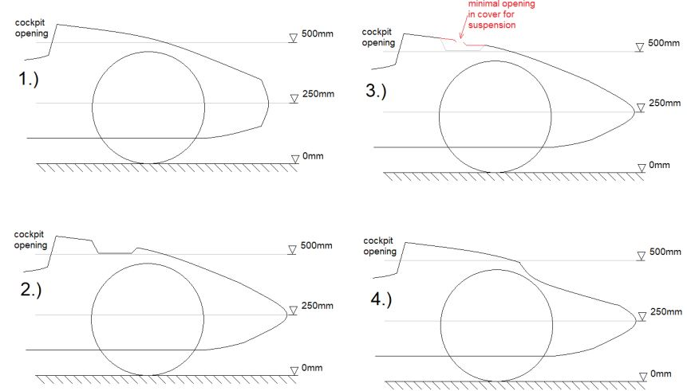

# Problem 837

Which of the following front bodywork designs is rules compliant? The drawings show a cross-section in side view at the vehicle center-line

Options:
- A) Drawing 2
- B) Drawing 4
- C) Drawing 1
- D) Drawing 3
